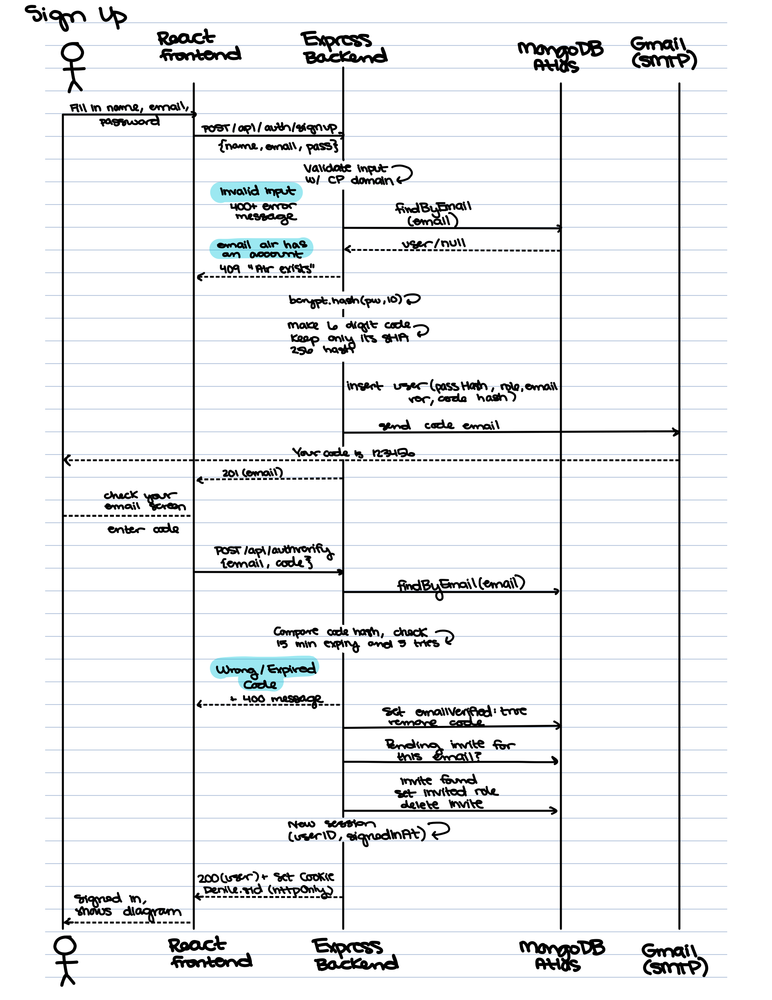
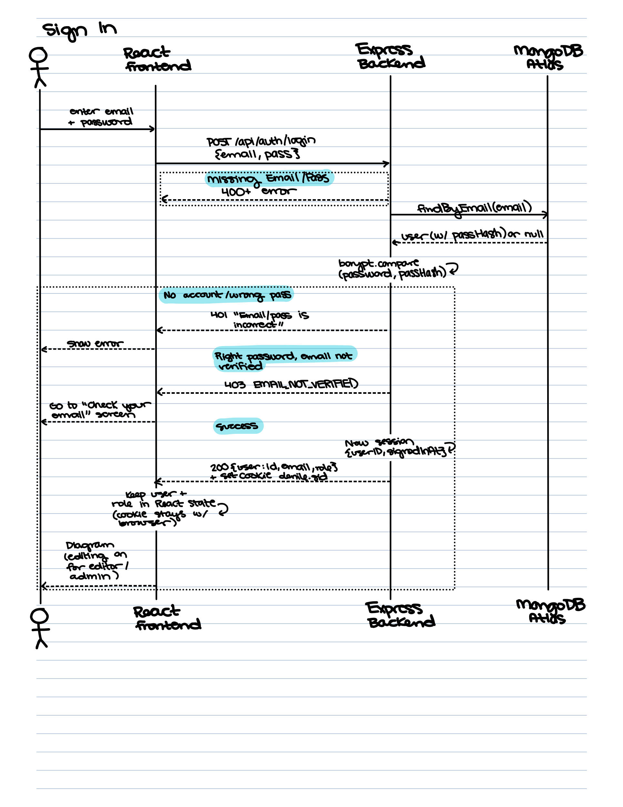
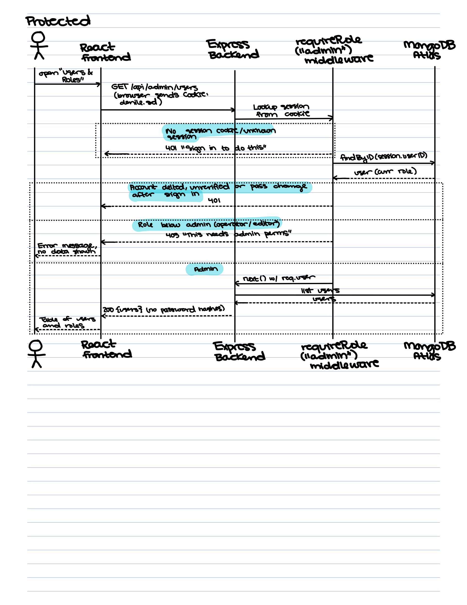

# DE-Nile

P&ID viewer for the NILE/RiverDash dashboard, with a planned
standalone editor.

- Scrum Master: Valerie Truong
- Product Owner: Stella Daoud
- Software Lead: Emilia Vu

## Development

Use Node.js 22.12+ (or a newer supported release).

```sh
npm ci
npm run build
npm test
npm run lint
npm run dev --workspace=de-nile
```

The default frontend retains the team’s existing canvas. Open
`/?viewerDemo=1` for the original diagram styling with simulated
pressure readings and valve states beneath the equipment labels. Turn off
simulation to see unavailable-data behavior. The demo never
connects to hardware.

## Repository structure

DE-Nile is an npm workspace repository. The standalone frontend
and the reusable viewer are separate packages so RiverDash can
embed the viewer without importing the standalone application.

```text
DE-Nile/
├── packages/
│   ├── react-frontend/          # Standalone React + TypeScript application
│   │   ├── src/
│   │   │   ├── diagram/         # Startup layout and shared editor node types
│   │   │   ├── App.tsx          # Existing interactive diagram canvas
│   │   │   ├── main.tsx         # Application entry and optional demo routing
│   │   │   ├── ViewerDemo.tsx   # Simulated viewer integration example
│   │   │   ├── demo.css         # Styles scoped to the optional demo
│   │   │   └── assets/          # Frontend image assets
│   │   └── package.json         # Development server and frontend build commands
│   ├── pid-viewer/              # @de-nile/pid-viewer npm package
│   │   ├── src/
│   │   │   ├── diagram.ts      # Configuration schema, types, and validation
│   │   │   ├── telemetry.ts    # Read-only RiverDash adapter and display formatting
│   │   │   ├── PIDViewer.tsx   # Embedded read-only React Flow viewer
│   │   │   ├── symbols.tsx     # Team equipment SVG symbols
│   │   │   ├── example-diagram.json
│   │   │   ├── style.css       # Viewer styles
│   │   │   ├── index.ts        # Public component, adapter, and type exports
│   │   │   └── bundle.ts       # Library build entry, including CSS
│   │   ├── tests/              # Configuration, telemetry, and viewer tests
│   │   ├── scripts/            # Build helpers for packaged assets
│   │   ├── dist/               # Generated JavaScript, declarations, CSS, and example
│   │   ├── package.json        # Package exports, dependencies, and build commands
│   │   └── README.md           # Package usage and RiverDash integration guide
│   └── express-backend/         # Express authentication server
├── docs/
│   └── data-format.md          # Version 1 saved P&ID configuration format
├── scripts/
│   └── check-riverdash.mjs      # Optional check against compiled RiverDash classes
├── package.json                # npm workspaces and repository-level commands
├── package-lock.json           # Locked workspace dependency versions
├── .gitignore                  # Dependency and generated-output exclusions
├── .prettierrc                 # Shared formatting configuration
├── AGENTS.md                   # Instructions for coding agents
├── SPEC.md                     # Requirements, scope, and acceptance criteria
├── project-context.md          # Confirmed decisions and open integration questions
├── contributing.md             # Team contribution guidelines
└── README.md                   # Project overview and development setup
```

This tree highlights the main source and documentation files;
build configuration, reference documents, and other supporting
files are omitted for readability.

### Package responsibilities

- **`react-frontend`** runs the standalone application. Its
  default view uses the team’s authentication flow and diagram
  canvas. The optional `/?viewerDemo=1` view connects simulated
  telemetry to the original diagram components using the package's
  shared reading types and formatter after sign-in or continuing
  as a viewer.
- **`pid-viewer`** is the package RiverDash imports. It
  validates saved diagrams, renders equipment and connections,
  and reads telemetry through the host-provided data source. It
  does not create a hardware connection or send hardware
  commands. Equipment positions remain fixed during monitoring,
  and the host can supply the team's SVG components through
  `renderSymbol`.
- **`express-backend`** provides account creation, sign-in,
  email verification, password reset, and roles. It has its own
  package and setup instructions in
  [the backend README](packages/express-backend/README.md).
  Start it separately for authentication; the embedded viewer
  continues to read telemetry from RiverDash's shared data
  table.

Treat `dist/` and npm package tarballs as generated output.
Change source files and rebuild rather than editing generated
files directly. The standalone diagram editor remains planned;
the existing canvas and demo do not constitute a complete
editor.

## Testing

### Running the tests

The backend isn't an npm workspace, so it gets its own install:

```sh
npm ci
npm ci --prefix packages/express-backend
npm run build
npm test
```

`npm test` at the root runs every package's tests: the
standalone frontend, the viewer package, then the backend. To
run one package at a time:

```sh
npm run test --workspace=de-nile                  # react-frontend
npm run test --workspace=@de-nile/pid-viewer      # pid-viewer
npm test --prefix packages/express-backend        # all backend tests
npm run test:system --prefix packages/express-backend  # system tests only
```

### System tests

**Tool:** Vitest + Supertest
**File:** `packages/express-backend/test/system.test.js`

A system test drives one feature end to end through the real
Express app: HTTP route → session and role check
(`requireRole`) → validation → data store → HTTP response. Each
test checks the response **and** what was actually saved.

| Test | Feature verified |
|---|---|
| An editor saves a diagram and gets it back | Create → stored → listed in the library → reopened with layout, pipes and telemetry bindings intact |
| Saves a new version without overwriting a newer save | Version 2 is saved; a save based on version 1 gets 409 and storage keeps version 2 |
| Refuses an operator's save | 403 "This needs editor permissions." and nothing is stored |
| Refuses requests from someone not signed in | 401 and nothing is stored |
| Operators only open the active diagram | Live diagram opens; a draft gets 403 `NOT_ACTIVE` |
| Rejects a pipe to a missing component | 400 "Pipe line1 connects to a missing component." |
| Rejects a diagram without a name | 400 "Give the diagram a name." |
| A new teammate signs up, verifies and signs in | Account stored unverified with a hashed password → sign-in refused (403) → emailed code verifies → signed in |

**Setup:** none. The tests use a temporary JSON data folder
instead of MongoDB and capture emails instead of sending them,
so no `.env` or database is needed. `test/mongo.test.js` runs
the same stores against a real MongoDB when `TEST_MONGODB_URI`
is set, and is skipped otherwise.

**Limitations:** the system tests stop at the API. They don't
send real email or exercise the React pages.

## Access control (TE6)

### Sign-up and email verification


### Sign-in


### Protected request (admin-only route)


## Additional documentation

- [P&ID data format](docs/data-format.md)
- [Viewer package and RiverDash integration](packages/pid-viewer/README.md)
- [Project specification](SPEC.md)
- [Confirmed project context](project-context.md)
- [Contribution guidelines](contributing.md)

Real telemetry tag contracts, host disconnect signaling, and
final CPSS symbol approval remain open. The GDT adapter uses a
provisional five-second update-silence timeout; see the package
README for cached-value handling and configuration. See
`SPEC.md` and `project-context.md` for project constraints.
