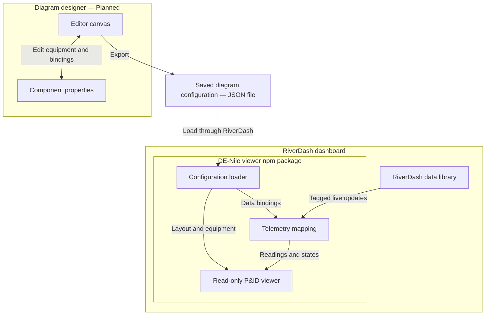

# DE-Nile Project Specification

DE-Nile provides a plumbing and instrumentation diagram (P&ID) viewer and planned diagram editor for the NILE test-stand dashboard. It shows how equipment is connected and displays live readings and equipment states supplied by RiverDash.

This specification describes the intended system. Features marked **Planned** are not claims of completed implementation.

## Users

- **Diagram designers:** Create and configure diagrams, equipment symbols, connections, and data bindings.
- **Test-stand engineers and operators:** View the diagram and monitor live equipment readings and states inside RiverDash.

## Project scope

The core deliverable is a read-only P&ID viewer that runs inside RiverDash. A standalone visual editor is a planned extension for creating and maintaining compatible diagrams.

### Core viewer

- Display tanks, check valves, pneumatic valves, pressure transducers, and rocket engines/nozzles using custom SVG symbols.
- Display equipment names, connection names, and pipe connections with configurable colors and right-angle turns.
- Load saved diagram configurations and reproduce equipment positions, connections, labels, styling, and data bindings.
- Match incoming RiverDash data to the appropriate components using stable data tags/keys.
- Display pressure readings, valve states, and other configured equipment states.
- Provide readable text for equipment states alongside colors or other visual indicators.
- Update live values without changing the saved arrangement of equipment.
- Adapt to different screen sizes and resizable dashboard panels.
- Run offline after installation with all required assets available locally.

### Diagram editor — Planned

- Operate independently of the running RiverDash dashboard when data names and types are available.
- Add, select, move, configure, and remove equipment symbols.
- Create and edit connections between equipment.
- Configure labels, label positions, state displays, data bindings, and line colors.
- Save and reopen diagrams for continued editing.
- Export a configuration that the embedded viewer can load.

### Outside the core scope

- Sending hardware commands, operating valves, or firing the test stand.
- Implementing the wider dashboard's logging, charts, authentication, or test-stand communication backend.
- Remote collaborative editing and custom animation authoring; these are optional future extensions.

## Functional requirements

| ID | Requirement | Completion criterion |
| --- | --- | --- |
| FR-01 | Render supported equipment types with SVG symbols. | A representative diagram displays all five equipment categories and their labels. |
| FR-02 | Render configurable connections between equipment. | Connection endpoints are correct; line colors and right-angle routing display as configured. |
| FR-03 | Load a saved diagram. | Loading a valid configuration reproduces its layout, connections, labels, and bindings. |
| FR-04 | Bind live telemetry to equipment. | Updating a tag changes the corresponding component's displayed value or state. |
| FR-05 | Keep states readable. | Operators can obtain a text representation of a state without relying only on color or animation. |
| FR-06 | Preserve the layout during monitoring. | Live updates change readings and states while equipment positions remain fixed. |
| FR-07 | Support different display sizes. | The diagram remains usable in laptop, larger-screen, and resized dashboard views. |
| FR-08 | Support offline viewing. | The installed viewer loads its assets and diagram without internet access. |
| FR-09 | Save and edit diagrams — Planned. | A designer can save a layout, reopen it, modify it, and export it for the viewer. |
| FR-10 | Handle invalid or unavailable data — Proposed. | Invalid configurations produce a useful error; unavailable readings are distinguishable from valid equipment states. |

## High-level design

The designer produces a configuration containing the diagram and its data bindings. RiverDash loads that configuration into the DE-Nile viewer and supplies live values through its data library or shared update callbacks.

The JSON file is a saved configuration, not a database. The final persistence implementation remains an open decision because the team's architecture draft also mentions database storage.

### Component responsibilities

| Component | Responsibility | Status |
| --- | --- | --- |
| `App.tsx` | Create the React Flow nodes and compose the interface. | Identified in the team design draft. |
| `PIDSymbolNode.tsx` | Present equipment nodes, including their symbols and display state. | Identified in the team design draft. |
| Editor and properties panel | Author layouts, connections, labels, and data bindings. | Planned. |
| Configuration loader | Parse the saved diagram and supply its layout and bindings. | Proposed module boundary. |
| Telemetry mapping | Match incoming tags to equipment and update display state. | Proposed module boundary. |
| `SymbolStrategies` | Hold equipment-specific symbol and state-display rules. | Planned. |
| RiverDash integration | Supply configuration and live updates to the embedded viewer. | Planned integration; exact interface requires agreement. |

These are responsibilities rather than a required repository folder structure. Exact implementation boundaries may change.

## Technology choices

| Area | Technology / approach |
| --- | --- |
| User interface | React and TypeScript |
| Diagram canvas | React Flow |
| Equipment graphics | Custom SVG symbols |
| Viewer distribution | npm package embedded in RiverDash |
| Configuration interchange | JSON files — proposed |
| Live data source | RiverDash data library / shared state and callbacks |

React Flow provides existing diagram interactions and connection handling. SVG symbols remain sharp as the diagram is resized or zoomed.

## Design pattern — Planned Strategy

Different equipment types require different graphics and display rules. For example, a pressure transducer displays a numerical reading, while a pneumatic valve displays an open/closed state.

The planned Strategy pattern moves equipment-specific behavior out of a growing conditional chain in `PIDSymbolNode.tsx`. Each strategy supplies the rules for one equipment type, and the node delegates to the strategy selected by its `data.kind`.

Adding an equipment type should require adding its strategy and registering it, rather than expanding one large rendering component. The exact strategy interface has not been finalized.

## Data and integration contract

The following describes the proposed information exchanged; it is not a finalized schema or API.

### Saved configuration

- Stable component IDs and equipment types.
- Component positions, labels, and display settings.
- Connections and their source/target component IDs.
- Connection colors and routing information.
- Data tags/keys bound to each component.
- Data types, units, and equipment-state display rules where needed.

### Live telemetry

RiverDash supplies a stable data tag/key and its current value. The integration must agree on how timestamps, units, data types, and quality/status information are represented.

DE-Nile uses those tags to update the correct equipment displays. It consumes telemetry through the host integration; hardware communication remains the responsibility of the wider system.

### Error behavior — Proposed

- Report malformed configuration files and unresolved connections.
- Distinguish missing, stale, or disconnected telemetry from a valid reading.
- Avoid displaying unavailable data as a valid zero or a confirmed equipment state.
- Agree with RiverDash on warning callbacks and stale-data thresholds before implementation.

## Quality requirements and constraints

- **Offline operation:** Bundle required scripts, fonts, symbols, and other assets locally. Runtime operation must not depend on CDNs or online APIs.
- **Read-only monitoring:** Viewer interactions must not send hardware-control commands.
- **Readable states:** Use text and units alongside visual state cues.
- **Responsive display:** Support different screen sizes and dashboard panel aspect ratios.
- **Maintainability:** Separate configuration loading, data binding, and equipment-specific display rules.
- **Performance:** Agree on representative diagram sizes and telemetry update rates before defining numerical targets. No measured performance guarantees are established by this specification.

## Acceptance checklist

- [ ] Load a representative NILE diagram containing every supported equipment category.
- [ ] Verify labels, connections, colors, right-angle routing, and configured readings.
- [ ] Feed simulated RiverDash updates and verify each tag updates only its bound displays.
- [ ] Verify live updates preserve the saved layout.
- [ ] Verify equipment states remain available as text.
- [ ] Resize the viewer and check diagram usability and label readability.
- [ ] Run the installed viewer with internet access disabled.
- [ ] Verify that the viewer cannot issue hardware-control commands.
- [ ] Check malformed configuration and unavailable-data behavior once implemented.
- [ ] Save, reopen, edit, and export a diagram once the planned editor is implemented.

## Open decisions

1. Final configuration schema, versioning, and validation rules.
2. Persistence ownership and technology: local JSON interchange versus any additional database storage.
3. RiverDash package interface, callback signatures, and telemetry metadata.
4. Stale-data thresholds and warning/error reporting behavior.
5. Editor delivery milestone and MVP boundaries.
6. Supported diagram size and telemetry update-rate targets.

## Reference documents

- *NILE Console_Dashboard Design.pdf*, pages 1 and 3–4: P&ID viewer requirements and editor extension.
- *TE4_ Identify Design.pdf*, pages 1 and 4–5: architecture draft, planned Strategy pattern, React Flow/SVG decision, and monitoring-only scope.
- Prior DE-Nile/RiverDash integration decisions: offline npm viewer, exported configuration, and tag-based live updates.
